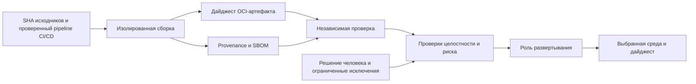

# Пример ревью: выпуск сервиса заказов

[CI/CD: требования к безопасному выпуску](../../ci-cd-release/overview.ru.md) / Пример ревью.

Синтетический учебный разбор, версия 0.2. Используются варианты `design-v0` и `design-v1`, а не реальные коммиты пользователя. Исправления предложены, проверки не выполнялись, статусы - `not-run`.

## Модель

Вымышленный сервис заказов собирается через GitHub Actions из защищенной ветки в OCI-образ. Независимый этап проверки связывает дайджест, provenance, SBOM, результаты сканирования и политику. Отдельная роль развертывания получает узкие краткоживущие полномочия только для выбранной среды. Человек оценивает оставшийся риск.

Имена `orders-synthetic`, `run-demo-01` и `<digest-A>` - учебные обозначения. Реальный комплект должен содержать точные репозиторий/SHA, ревизию pipeline CI/CD, дайджест, идентичности системы сборки и подписанта, версии политик и инструментов, время наблюдений и защищенные ссылки на доказательства. Не заменяйте их правдоподобными вымышленными хешами.

## Замечания и ожидаемая повторная проверка

| ID | Вариант design-v0 и риск | Предложение design-v1 | Проверки | Статус |
| --- | --- | --- | --- | --- |
| F-REL-001 | После согласования этап развертывания берет `latest`; тег можно заменить | Продвигать и развертывать проверенный дайджест, не пересобирать; REL-004/009 | Замена тега не меняет объект; новые байты отклонены; штатное продвижение сохраняет дайджест | `not-run` |
| F-REL-002 | Принимается любая валидная подпись, provenance не связан с системой сборки/SHA | Явная политика подписанта и системы сборки, проверка объекта `subject` и исходников; REL-005/006 | Чужая идентичность, система сборки, SHA или дайджест отклонены; выбранная цепочка допускается | `not-run` |
| F-REL-003 | Ручное согласование скрывает отсутствующий SBOM и незавершенное сканирование | Учет отсутствующих результатов, независимые проверки допуска и ограниченные исключения; REL-007/008/010 | Пустой результат не становится `pass`; исключение ограничено дайджестом и сроком; отказ не отменяет обязательную проверку целостности | `not-run` |

Это гипотезы учебной архитектуры. Для подтверждения дефекта своего проекта нужны достижимость, предпосылки, последствия и наблюдения на точной ревизии. Историческая оценка, применение исправления и итог повторной проверки - отдельные состояния.

## Прослеживаемость и повторная проверка

| Замечание | Требования | ID проверок из CSV | Исправление / повторная проверка |
| --- | --- | --- | --- |
| F-REL-001 | REL-004, REL-009 | REL-T-05, REL-T-12, REL-T-13, REL-T-15 | Предложено / `not-run` |
| F-REL-002 | REL-005, REL-006 | REL-T-06, REL-T-07, REL-T-08, REL-T-17, REL-T-18 | Предложено / `not-run` |
| F-REL-003 | REL-007, REL-008, REL-010 | REL-T-09, REL-T-10, REL-T-11, REL-T-14, REL-T-19 | Предложено / `not-run` |

Для своего прогона укажите `finding_ids`, исходную и исправленную ревизии, состояние исправления и отдельные поля повторной проверки CSV. Не подменяйте фактическую ревизию исправления обозначением design-v1. Новые требования и тесты являются планом проверки, а не подтвержденными замечаниями.

## Пример записи решения

| Поле | Учебное значение |
| --- | --- |
| Область | Выпуск `orders-synthetic`, вариант `design-v1` |
| Артефакт | `<digest-A>`; фактический дайджест не вычислялся |
| Целостность / provenance / подпись | `not-run` / `not-run` / `not-run` |
| SBOM и применимость уязвимостей | `not-run`; состав не исследовался |
| Исправления | Предложены, не применялись |
| Повторная проверка | `not-run` |
| Исключения | Не выданы |
| Решение о реальном выпуске | Не принято; требуется ответственный человек и фактические доказательства |

Скачайте [шаблон решения и матрицу](../../ci-cd-release/overview.ru.md), сохраните ID, заполните наблюдения и отдельно укажите неисполненные проверки. Откат должен ссылаться на проверенный предыдущий артефакт, а не на обход проверок допуска.

Автор: Defrixx. CC BY 4.0. [Использование и лицензии](../../usage/overview.ru.md).
