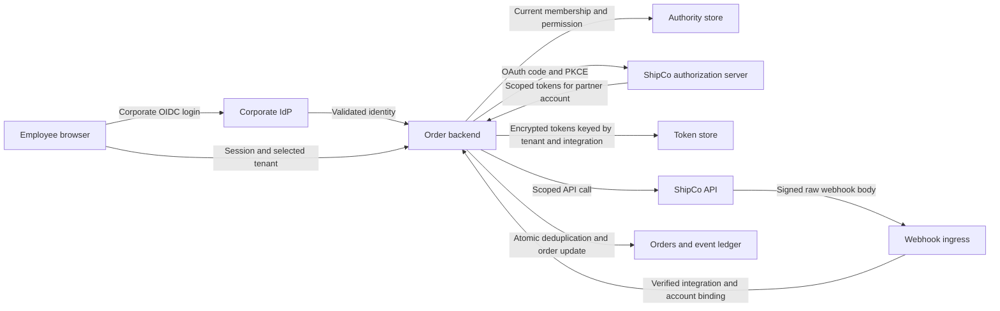

# Review example: delivery integration

<!-- hub:review-breadcrumb -->

Synthetic learning case, version 0.2. The project is fictional and the review compares design options: no real service received these repairs and no tests were executed here. Tables describe expected observations, not a passing test report.

## Scope and inputs

A multi-tenant order service connects to the fictional ShipCo provider. Tenants `alpha` and `beta` have different employees, integrations and orders; external order IDs may collide. A corporate IdP handles employee login. ShipCo issues backend OAuth tokens after an authorized user grants access. The browser holds no partner tokens. Signed webhooks update only orders belonging to the matching integration.

`design-v0` and `design-v1` below identify teaching designs, not Git commits. In a real report replace them with exact SHAs and working-tree state.

## Trust diagram

Boundaries: browser/backend, backend/IdP, backend/ShipCo, webhook/backend, backend/stores. Bind the session to a validated `iss`/`sub` pair; the authority store determines membership. The integration stores `(tenant_id, integration_id, partner_account_id)`; an order uses `(tenant_id, integration_id, external_order_id)`. Obtain the partner account through a verified API using the issued token, never a browser-supplied field.

## OAuth and integration lifecycle

The corporate OIDC client checks the trusted issuer, permitted algorithm/key, `aud`, `exp` and single-use `nonce`; validate additional claims and time limits under the selected client profile. Rotate the session after login and protect it against CSRF. Partner OAuth uses a separate backend client: TLS, registered endpoints, PKCE `S256`, configured client authentication and an exact redirect URI.

The single-use transaction binds `state`, session, tenant, integration generation, expiry, PKCE and expected authorization server. With multiple servers use supported response `iss` validation or distinct redirect URIs; `state` without server binding does not prevent mix-up. Expired transactions, denied consent, disconnect or generation changes before completion block activation.

Disconnect atomically changes state/generation. The webhook handler checks current state/generation and mutates the order in one transaction, using a lock or conditional update. Disconnect synchronizes with that transaction; disabled integrations accept no new mutations. Dispatch workers recheck state before handing off a job and separately account for requests already sent. In this case reconnect creates a new `integration_id` and keys; the old webhook endpoint remains disabled. Never reuse the old identifier, so old events are not inherited by the new connection. Remote revocation is separate, with bounded retries. A local flag cannot undo a request already accepted by the partner: retain the unknown outcome and reconcile without creating another delivery.

## Outbound delivery and unknown outcomes

In the fictional ShipCo contract, one create operation has a random key persisted before sending, bound to `(tenant_id, integration_id, generation, order_id, operation_id)`, and immutable request contents. Retries reuse the key; changed contents under that key are rejected. Include no personal data in keys. Allocate the business-operation identifier once; a unique operation record prevents parallel workers from creating different keys for one command. Commit the job record with the order change; workers coordinate dispatch and retain the key across failures. The partner must support agreed key retention and result lookup.

After a timeout reconcile using the same key or operation identifier. Beyond confirmed idempotency retention, or without reconciliation, stop automatic re-creation and hand the uncertainty to a human. This is a requirement of the selected contract, not a promise made by every API. Test normal retries, lost responses, concurrent dispatch and restart separately from inbound webhook duplicates.

## Specific webhook contract

This is **only the fictional ShipCo contract**. Endpoint `/hooks/shipco/{integration_id}` selects a preregistered integration and its keys; the path alone grants no authority.

- TLS; a 64 KiB body limit is a selected case constraint, assuming events up to 16 KiB.
- Headers: `X-ShipCo-Timestamp` (integer UTC seconds), `X-ShipCo-Event-Id`, `X-ShipCo-Key-Id`, `X-ShipCo-Signature` (exactly 64 hex characters). Reject duplicate, missing or malformed values.
- Signed bytes: `timestamp + "." + event_id + "." + raw_body`; HMAC-SHA-256, constant-time comparison of decoded values. Metadata has a defined ASCII format without dots: event ID up to 128 `[A-Za-z0-9_-]` characters, timestamp up to 12 digits. Do not parse or reserialize the body before verification. Use the exact contract bytes before intermediary transformations.
- Accept at most 300 seconds of clock skew in either direction: a case assumption about clocks and latency. ShipCo signs each delivery attempt with a fresh timestamp; automatic retries last at most 24 hours. These values are not universal provider defaults.
- Signed JSON requires `event_type`, `account_id`, `order_id`, `status`, `version`. Reject duplicate JSON keys. Validate a closed schema, known event type, the integration's account and an allowed order transition. Never select the tenant using a payload `tenant_id`.
- Enforce unique `(integration_id, event_id)` in storage and commit event registration and order mutation in one transaction. Keep deduplication records at least 25 hours after receipt for the assumed 24-hour retry horizon; an older signed request then fails the time check. Providers allowing later retries with fresh signatures need longer records or a permanent business-operation key.
- Store the body hash with `(integration_id, event_id)`: a valid duplicate has identical contents. Reject and record a reused ID with a different body without mutating the order; a new signature timestamp does not change event identity.
- Two parallel requests and two different event IDs for the same business operation must not repeat the effect: check `version` and legal transitions. A separate external effect needs a transactional outbox and an idempotent receiver; a local transaction does not make a remote call atomic.
- Acknowledge success after commit, including an already processed valid duplicate. A failure before commit may be retried. Rotation accepts only explicitly selected current/previous keys for this integration for a bounded period; reject unknown key IDs.

## Requirements and checks

| ID | Case requirement | Allowed case | Rejection or recovery check |
| --- | --- | --- | --- |
| API-001 | Validate corporate OIDC: trusted issuer, signature, audience, expiry and nonce binding; identify users by iss/sub | Employee logs in through the selected IdP | Wrong issuer/audience, expired token or mismatched nonce creates no session |
| API-002 | Check current tenant membership and `integrations.manage` at OAuth initiation and completion; session/CSRF protection | Authorized alpha employee connects alpha | Beta employee, read-only user or role revoked during OAuth cannot change the integration |
| API-003 | Code flow with PKCE S256; exact redirect URI; single-use server transaction binds state, browser session, tenant, integration and expected OAuth server | Callback completes the original transaction once | Tenant/state substitution, cross-session use, repeated code or wrong issuer is rejected |
| API-004 | Request only `shipments.write` and `shipments.read` for the selected account; verify granted scopes and authenticated account ID | Delivery is created for the bound account | Extra/missing scopes or substituted account blocks activation |
| API-005 | Encrypt backend tokens with separately managed keys; exclude browser, URLs and logs; partition access by tenant/integration | Background dispatch continues after employee logout under the explicit integration model | Disconnect immediately prevents token access and new jobs, then revokes at the partner; revocation failure does not reactivate it |
| API-006 | Validate bytes, HMAC, timestamp, key ID and size under the contract before processing; bind account/order to integration | A valid alpha event changes alpha's order | Modified byte, beta key, foreign account/order or out-of-window timestamp changes no data |
| API-007 | Atomically register event ID and mutation; separately prevent duplicate business operations and illegal ordering | A valid transition happens once | Parallel replay, failure before/after commit or an old version delivered again produces no second effect |
| API-008 | Record authority, lifecycle, selected revision and results without secrets; a human owns release decisions | Another engineer can reproduce the checks | Unexecuted tests never become pass; uncertain outcomes are not verified repairs |
| API-009 | Bind outbound delivery creation to tenant, integration generation and order; persist an idempotency key and immutable request | Normal dispatch creates one delivery | Lost response, concurrent dispatch and restart/retry create no second delivery; reconcile unknown outcomes first |

An omitted OAuth `scope` response does not mean zero permissions: OAuth 2.0 permits omission when granted scopes equal those requested. Use the stored request and documented server contract; changed scopes must be represented explicitly. Do not parse an opaque token as a JWT to infer permissions.

Scopes above are fictional ShipCo names. Employee role revocation blocks management but does not automatically revoke an independent tenant integration: disconnect and OAuth revocation are separate transitions. Refresh-token rotation needs atomic replacement, serialized refresh and bounded failure handling.

## Findings, repairs and rechecks

| ID | design-v0 and consequence | Proposed design-v1 | Expected recheck |
| --- | --- | --- | --- |
| F-001 | Callback takes tenant from query; an alpha employee can bind delivery to beta | Single-use server OAuth transaction and current authority; API-002/003 | Original substitution, other session and revoked role rejected; legitimate connection allowed |
| F-002 | Signature is verified but order lookup uses only external ID; colliding IDs cross tenants | Integration/account binding and composite order key; API-006 | Signed foreign account/order changes nothing; own order is updated |
| F-003 | `seen(event)` and UPDATE are separate; two workers change the order twice | Unique key, shared transaction and domain version; API-007 | Synchronized duplicates and commit-boundary failure yield one effect; the next valid transition succeeds |

All three findings are teaching hypotheses in design-v0; repairs are proposed in design-v1; verification **was not executed**. A real assessment needs reachability, impact, priority and observations at a selected revision. Do not attach real CVSS scores or a fixed verdict to this example.

## Traceability and rechecks

| Finding | Requirements | CSV test IDs | Repair / recheck |
| --- | --- | --- | --- |
| F-001 | API-002, API-003 | T-004, T-005, T-020 | Proposed / `not-run` |
| F-002 | API-006 | T-009, T-010, T-014, T-019 | Proposed / `not-run` |
| F-003 | API-007 | T-011, T-012, T-013, T-022 | Proposed / `not-run` |

For your run fill in `finding_ids`, baseline/repair revisions, repair state and separate CSV recheck fields. Never substitute design-v1 for an actual repair revision. New requirements and tests are a test plan, not confirmed findings.

## Handoff

[Download the template and CSV](../../api-integration/overview.en.md), retain IDs and record observed outcomes. A human decides release readiness with remaining risks, exceptions, owners and review dates. This case contains no real-service release decision.

Author: Defrixx. Original prose and diagram: CC BY 4.0. [Usage and licenses](../../usage/overview.en.md).
