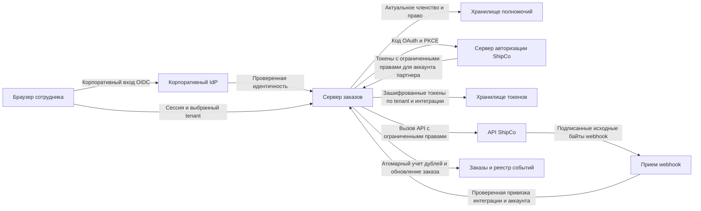

# Пример ревью: подключение доставки

<!-- hub:review-breadcrumb -->

Синтетический учебный кейс, версия 0.2. Это вымышленный проект и разбор проектных решений: описанные исправления не применялись к реальному сервису, тесты здесь не исполнялись. Таблицы показывают ожидаемые наблюдения, а не отчет о пройденных проверках.

## Область и входные данные

Сервис заказов с несколькими арендаторами (tenant) подключает вымышленный ShipCo. Для tenant `alpha` и `beta` есть разные сотрудники, интеграции и заказы; внешние номера заказов могут совпадать. Корпоративный IdP обслуживает вход сотрудников. ShipCo выдает серверу OAuth-токены после согласия уполномоченного пользователя. Браузер не хранит эти токены. Подписанные webhook меняют только заказы соответствующей интеграции.

Ревизии `design-v0` и `design-v1` ниже - обозначения вариантов учебной архитектуры, а не Git-коммиты. В реальном отчете замените их точными SHA и состоянием дерева.

## Схема доверия

Границы: браузер/сервер, сервер/IdP, сервер/ShipCo, webhook/сервер, сервер/хранилища. Сессия связывается с проверенной парой `iss`/`sub`; доверенное хранилище определяет членство. Интеграция хранит `(tenant_id, integration_id, partner_account_id)`, заказ - `(tenant_id, integration_id, external_order_id)`. Аккаунт партнера получают через проверенный API с выданным токеном, а не из поля браузера.

## OAuth и жизненный цикл интеграции

Корпоративный клиент OIDC проверяет доверенного издателя, разрешенный алгоритм и ключ, `aud`, `exp` и одноразовый `nonce`; дополнительные поля и временные ограничения проверяются по выбранному профилю клиента. Сессия меняется после входа и защищена от CSRF. Клиент OAuth партнера - отдельный серверный клиент: TLS, зарегистрированные конечные точки, PKCE `S256`, настроенная аутентификация клиента и точный URI перенаправления.

Одноразовая транзакция связывает `state`, сессию, tenant, интеграцию, ее версию, срок, PKCE и ожидаемый сервер авторизации. При нескольких серверах используют поддерживаемую проверку `iss` ответа либо разные URI перенаправления; одного `state` без привязки сервера недостаточно против смешения серверов. Истекшая транзакция, отказ в согласии, отключение или смена версии интеграции до завершения подключения запрещают активацию.

Отключение атомарно меняет состояние/версию. Обработчик webhook связывает проверку актуального состояния/версии с изменением заказа в одной транзакции, используя блокировку либо условное обновление. Отключение синхронизируется с этой транзакцией; отключенная интеграция не принимает новые изменения. Фоновая отправка повторно проверяет состояние перед выдачей задания, отдельно учитывая уже отправленные запросы. В этом кейсе повторное подключение получает новый `integration_id` и ключи; прежний адрес webhook остается отключенным. Старый идентификатор не переиспользуется, поэтому старое событие не наследуется новой связью. Удаленный отзыв выполняется отдельно с ограниченными повторами. Уже принятый партнером запрос нельзя отменить локальным флагом: сохраните неизвестный исход и выполните сверку без нового создания доставки.

## Исходящая доставка и неизвестный результат

В вымышленном контракте ShipCo одна операция создания имеет случайный ключ, сохраненный до отправки и связанный с `(tenant_id, integration_id, generation, order_id, operation_id)`, и неизменяемое содержимое запроса. Повторы используют тот же ключ; другое содержимое с ним отклоняется. Ключ не содержит персональных данных. Идентификатор бизнес-операции выделяется один раз; уникальность записи операции не дает параллельным обработчикам создать разные ключи для одной команды. Запись задания фиксируется с изменением заказа; обработчики координируют выдачу задания и сохраняют ключ после сбоя. Партнер должен поддерживать согласованный срок учета ключей и способ поиска результата.

После тайм-аута сначала сверяют операцию по тому же ключу или идентификатору. За пределами подтвержденного срока идемпотентности либо без способа сверки автоматическое повторное создание останавливают и передают неопределенность человеку. Это требование выбранного контракта, а не обещание всех API. Проверяют штатный повтор, потерянный ответ, параллельную отправку и перезапуск отдельно от дублей входящего webhook.

## Конкретный контракт webhook

Это **только контракт вымышленного ShipCo**. Конечная точка `/hooks/shipco/{integration_id}` выбирает предварительно зарегистрированную интеграцию и ее ключи; путь сам по себе не дает полномочий.

- TLS; максимальный размер тела 64 KiB - выбранное ограничение этого кейса. Для него предполагаются события до 16 KiB.
- Заголовки `X-ShipCo-Timestamp` (целые секунды UTC), `X-ShipCo-Event-Id`, `X-ShipCo-Key-Id`, `X-ShipCo-Signature` (ровно 64 hex-символа). Повторные, отсутствующие или некорректные значения отклоняются.
- Подписываемые байты: `timestamp + "." + event_id + "." + raw_body`; HMAC-SHA-256, сравнение декодированных значений за постоянное время. В метаданных допускается только заранее определенный ASCII-формат без точки: event ID до 128 символов `[A-Za-z0-9_-]`, timestamp до 12 цифр. До проверки подписи тело не разбирают и не сериализуют заново. Используют точные байты, выданные контрактом до преобразований посредниками.
- Допустимое отклонение времени 300 секунд в обе стороны - предположение кейса о часах и задержке. ShipCo повторно подписывает каждую попытку с новым timestamp; автоматические повторы длятся не более 24 часов. Это не универсальные значения для поставщиков.
- В подписанном теле обязательны `event_type`, `account_id`, `order_id`, `status`, `version`. Повторные JSON-ключи отклоняются. Проверяются закрытая схема, известный тип события, совпадение аккаунта интеграции и допустимый переход состояния заказа. `tenant_id` из тела не используется для выбора tenant.
- Уникальность `(integration_id, event_id)` обеспечивается хранилищем, а регистрация события и изменение заказа проходят одной транзакцией. Отметки хранят минимум 25 часов после приема для принятого 24-часового горизонта повторов; после этого старый подписанный запрос отсекает проверка времени. Если поставщик допускает более поздний повтор с новой подписью, нужны более долгий учет или постоянный доменный ключ операции.
- Сохраняйте хеш тела вместе с `(integration_id, event_id)`: допустимый дубль имеет то же содержимое. Повторный ID с другим телом отклоняется и фиксируется без изменения заказа; новое время подписи не меняет идентичность события.
- Два параллельных запроса и два разных event ID одной операции не должны давать повторный эффект: проверяются `version` и допустимый переход. При отдельном внешнем эффекте нужен transactional outbox и идемпотентный получатель; локальная транзакция не делает внешний вызов атомарным.
- После фиксации транзакции возвращается успешное подтверждение, в том числе для уже обработанного допустимого дубля. При сбое до фиксации транзакции возможен повтор. Ротация допускает только явно выбранные действующий/предыдущий ключи данной интеграции в ограниченный срок; неизвестный key ID отклоняется.

## Требования и проверки

| ID | Требование кейса | Разрешенный случай | Отклонение или проверка восстановления |
| --- | --- | --- | --- |
| API-001 | Валидировать корпоративный OIDC: доверенный issuer, подпись, audience, срок и привязку nonce; идентичность хранить как iss/sub | Сотрудник входит через выбранный IdP | Иной issuer/audience, истекший токен, чужой nonce не создают сессию |
| API-002 | Проверять актуальное членство и право `integrations.manage` для tenant на старте и завершении OAuth; защита сессии/CSRF | Уполномоченный сотрудник alpha подключает alpha | Сотрудник beta, обычный читатель и отозванная во время OAuth роль не меняют интеграцию |
| API-003 | Code flow с PKCE S256; точный redirect URI; одноразовая серверная транзакция связывает state, сессию браузера, tenant, интеграцию и ожидаемый сервер OAuth | Callback завершает исходную транзакцию один раз | Подмена tenant/state, перенос между сессиями, повтор кода и неверный issuer отклоняются |
| API-004 | Запрашивать только `shipments.write` и `shipments.read` для выбранного аккаунта; сверять выданные scopes и проверенный account ID | Доставка создается для связанного аккаунта | Лишние/недостающие scopes или подмена аккаунта останавливают активацию |
| API-005 | Хранить токены зашифрованно на сервере с отдельным управлением ключами; исключить браузер, URL и журналы; раздельный доступ по tenant/integration | Фоновая отправка работает после выхода сотрудника по явной модели интеграции | Отключение интеграции немедленно блокирует выдачу токенов и новые задания, затем выполняется отзыв у партнера; ошибка отзыва не включает интеграцию обратно |
| API-006 | Проверять байты, HMAC, timestamp, key ID и размер по контракту до обработки; account/order привязывать к интеграции | Корректное событие alpha меняет заказ alpha | Измененный байт, ключ beta, чужой аккаунт/заказ и timestamp за окном не меняют данные |
| API-007 | Атомарно учитывать event ID и изменение; отдельно защищать доменную операцию от дублей и нарушения порядка | Допустимый переход выполняется один раз | Параллельный повтор, сбой до/после фиксации транзакции и новая доставка старой версии не дают второго эффекта |
| API-008 | Фиксировать разрешения, жизненный цикл, выбранную ревизию и результаты без секретов; решение о выпуске принимает человек | Отчет позволяет повторить проверку | Неисполненный тест не становится pass; неопределенный исход не считается исправлением |
| API-009 | Связывать исходящее создание доставки с tenant, интеграцией, ее версией и заказом; сохранять ключ идемпотентности и неизменяемый запрос | Штатная отправка создает одну доставку | Потерянный ответ, параллельный запуск и повтор после перезапуска не создают вторую доставку; неизвестный исход сначала сверяют |

Если `scope` отсутствует в ответе OAuth, это не означает нулевые права: по OAuth 2.0 поле можно опустить, когда выданный набор совпадает с запрошенным. Используйте сохраненный запрос и документированный контракт сервера; при измененном наборе требуется его явное представление. Не разбирайте непрозрачный токен как JWT ради определения прав.

Scopes выше - вымышленные имена ShipCo. Отзыв роли сотрудника блокирует управление, но не равен отзыву самостоятельной tenant-интеграции: ее отключение и отзыв OAuth описаны отдельно. При ротации refresh token необходимо атомарное обновление, исключение параллельного refresh и обработка отказа без бесконечных повторов.

## Замечания, исправления и повторная проверка

| ID | Вариант design-v0 и последствие | Предложение design-v1 | Ожидаемая повторная проверка |
| --- | --- | --- | --- |
| F-001 | Callback берет tenant из query; сотрудник alpha может привязать доставку к beta | Серверная одноразовая OAuth-транзакция плюс актуальные права; API-002/003 | Исходная подмена, чужая сессия и отзыв роли отклонены; штатное подключение разрешено |
| F-002 | Подпись проверяется, но заказ ищется только по внешнему ID; совпадение ID пересекает tenant | Связь интеграции, аккаунта и составного ключа заказа; API-006 | Подписанное событие с чужим account/order ничего не меняет; свой заказ обновляется |
| F-003 | `seen(event)` и UPDATE выполняются отдельно; два обработчика меняют заказ дважды | Уникальный ключ, общая транзакция, доменная версия; API-007 | Синхронные дубли и сбой на границе фиксации транзакции дают один эффект; следующий допустимый переход проходит |

Статус всех трех замечаний: учебная гипотеза в `design-v0`; исправление предложено в `design-v1`; повторная проверка **не выполнялась**. Для реального проекта нужны подтверждение достижимости, последствия, приоритет и наблюдения на выбранной ревизии. Не присваивайте этому примеру реальные CVSS или статус «исправлено».

## Прослеживаемость и повторная проверка

| Замечание | Требования | ID проверок из CSV | Исправление / повторная проверка |
| --- | --- | --- | --- |
| F-001 | API-002, API-003 | T-004, T-005, T-020 | Предложено / `not-run` |
| F-002 | API-006 | T-009, T-010, T-014, T-019 | Предложено / `not-run` |
| F-003 | API-007 | T-011, T-012, T-013, T-022 | Предложено / `not-run` |

Для своего прогона укажите `finding_ids`, исходную и исправленную ревизии, состояние исправления и отдельные поля повторной проверки CSV. Не подменяйте фактическую ревизию исправления обозначением design-v1. Новые требования и тесты являются планом проверки, а не подтвержденными замечаниями.

## Передача результата

[Скачайте шаблон и CSV](../../api-integration/overview.ru.md), сохраните ID и заполните фактические результаты. Человек принимает решение по выпуску с учетом оставшихся рисков, исключений, ответственных и сроков пересмотра. Этот кейс не содержит решения о выпуске реального сервиса.

Автор: Defrixx. Авторский текст и схема - CC BY 4.0. [Использование и лицензии](../../usage/overview.ru.md).
