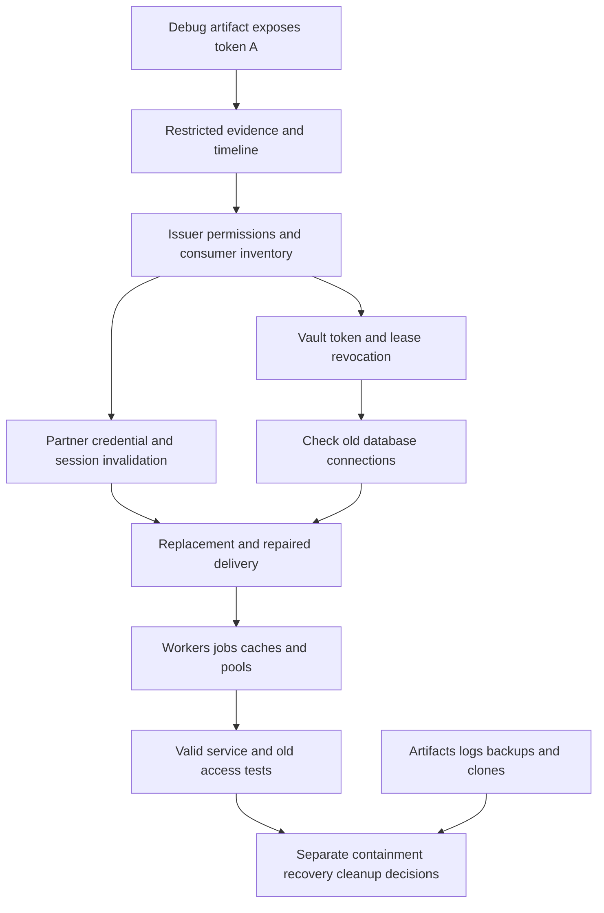

# Review example: Secret exposure in a running service

[Secret exposure in a running service](../../secret-exposure-response/overview.en.md) / Review example.

Synthetic design review, version 0.1. `design-v0` and `design-v1` are fictional design options, not commits. Findings are teaching hypotheses; repairs are proposed, not applied. All baseline checks and rechecks are `not-run`. No issuer, database or service is contacted.

## Model and assumptions

The fictional `report-worker-demo` uses a Vault service token represented only by alias `worker-vault-A`. A debug export includes its value in a build artifact. These aliases are not usable credentials. The earliest plausible exposure is the first artifact publication; audit gaps before detection remain unknown rather than evidence of no misuse.

The token can read a static partner credential and request a dynamic database credential for the worker role. The inventory therefore includes the Vault token, every accessible static credential, issued database leases, derived partner sessions and existing database connections. Evaluate actual permissions and issue/access history; do not equate the displayed policy name with effective scope. The partner-session mechanism is a fictional contract for this case, not Vault or database behavior.

Containment uses the approved incident procedure to revoke the exposed Vault token and verify associated lease revocation outcomes. It separately revokes the static credential at the partner issuer and invalidates partner sessions using the partner contract. Removing the KV entry does not perform that external revocation. A failed lease/backend revocation remains open and requires an effective resource-side restriction and an owner.

Changing a database password and stopping new authentication do not establish termination of an already authenticated connection. The selected database/backend procedure must check existing sessions and terminate or otherwise deny their protected operations where necessary. Temporary cloud credentials, if discovered in the scope, follow the Cloud IAM procedure: removing federation trust only stops new issuance; already issued credentials need their own effective-denial check. An identity-only diagnostic such as AWS `GetCallerIdentity` is not a test that protected resource access was denied.

A replacement Vault identity and partner credential use reviewed minimum permissions. The leak-producing debug path is repaired before replacement delivery. Each active worker and scheduled job must demonstrate the new alias/version; cached sessions and database pools have explicit reload/reconnect handling. Authorized tests use isolated fixtures, including a valid report operation and attempts through old credentials, old sessions and a stale worker.

Repository/artifact/log cleanup follows containment and preserves restricted evidence. Unknown external clones and retained backups are recorded with owners, access restrictions and next actions. Restoring a backup or rolling back the worker must retain current credential references and repaired logging. Re-encrypting a KV copy does not undo the disclosure of plaintext.

## Trust diagram

## Findings and proposed repairs

| ID | design-v0 / impact | Proposed design-v1 | Requirements / tests | Recheck |
| --- | --- | --- | --- | --- |
| F-SEC-001 | Only the latest source file is inspected and an artifact is removed; the Vault token and partner access remain usable | Protected timeline, issuer/permission/consumer inventory and immediate compromise containment | SEC-001, SEC-002, SEC-003; SEC-T-01, SEC-T-02, SEC-T-03, SEC-T-04, SEC-T-05, SEC-T-06 | `not-run` |
| F-SEC-002 | KV is updated and new login fails; the old static partner credential, derived session or active DB connection is omitted | Issuer-side revocation results plus separate derived/session/connection tests and effective resource denial when needed | SEC-004, SEC-007; SEC-T-07, SEC-T-08, SEC-T-13, SEC-T-14 | `not-run` |
| F-SEC-003 | Replacement uses the same leaking debug path; a stale scheduled worker and rollback still select the old version | Repair delivery, restrict replacement rights, verify each consumer and keep rollback on clean credentials | SEC-005, SEC-006, SEC-009; SEC-T-09, SEC-T-10, SEC-T-11, SEC-T-12, SEC-T-17, SEC-T-18 | `not-run` |
| F-SEC-004 | A clean scan closes the incident while an old artifact and protected evidence retention are untracked | Track copies and close containment, recovery and cleanup separately against observed evidence | SEC-008, SEC-010; SEC-T-15, SEC-T-16, SEC-T-19, SEC-T-20 | `not-run` |

Confirm each hypothesis in your project using exact revisions, scope and observations. Preserve the original finding and assess a separate recheck; expected results are not evidence.

## Example decision record

| Field | Synthetic value |
| --- | --- |
| Scope | `report-worker-demo`, `design-v1` |
| Repairs | Proposed; no actual repair revision |
| Containment / recovery / cleanup | Not executed / not executed / not executed |
| Checks / rechecks | `not-run` / `not-run` |
| Observations and evidence | Absent; no credential or infrastructure actions performed |
| Exceptions | None granted |
| Real incident closure | Not taken; the accountable human reviews observed evidence and remaining work |

[Review template and test matrix](../../secret-exposure-response/overview.en.md). Record real revisions, authorized observations and protected evidence references; fictional design IDs do not replace SHAs.

Author: Defrixx. CC BY 4.0. [Usage and licenses](../../usage/overview.en.md).
