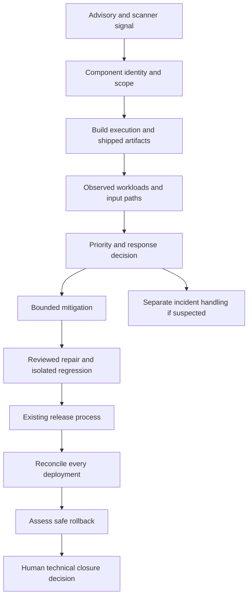

# Review example: Urgent vulnerability in a running product

[Urgent vulnerability in a running product](../../vulnerability-response/overview.en.md) / Review example.

Synthetic design review, version 0.1. `design-v0` and `design-v1` are fictional design options, not commits. Findings are teaching hypotheses; repairs are proposed, not applied; baseline checks and rechecks were not executed.

## Model and assumptions

Fictional `report-service-demo` parses partner documents using `parser-demo` in an API and a background worker. Two fictional regions serve requests. `ADVISORY-DEMO-01` is a teaching identifier, not a real CVE or vendor notice. Its assumed affected range is `parser-demo` 1.x, with an assumed repair in 2.x. These version conditions describe only this example and must be replaced by the actual vendor conditions in a real assessment.

The scenario starts with a scanner signal for the API image and a vendor-like advisory record. Scope includes the API, background workers, scheduled replay jobs, both regions and a build step that uses the parser for test fixture conversion. Names and artifact labels below are fixtures; use actual digests and immutable revisions in your assessment. The report contains no executable payload, real secret or live target.

In `design-v0`, the manifest is changed to 2.x, but a bundled 1.x copy remains in a worker. A clean API scan is treated as proof that the whole service is repaired. A temporary API feature flag has no effect on worker queue processing. Deployment succeeds in one region while the other retains an old worker image. The default rollback target also contains the affected parser. No real state was inspected to confirm these hypotheses.

## Proposed response in design-v1

1. Preserve the original advisory revision and scanner/database identity. Confirm ecosystem, component identity and exact affected conditions; trace resolved and bundled copies to artifact digests/platforms and actual workloads. Keep build-time use separate from runtime presence.
2. Record externally reachable parsing and queued partner input as distinct paths. Unknown inventory or reachability remains unresolved. Determine response priority under the vulnerability-management playbook; credible compromise evidence starts incident handling with its own owner and evidence retention.
3. Temporarily disable the affected parsing operation at both API and worker boundaries under a recorded, expiring decision. Preserve queued item identities and restricted evidence for an authorized recovery decision; do not silently acknowledge or discard accepted work. The unaffected status endpoint remains available. This mitigation is not a claim that the parser is fixed.
4. Propose a reviewed upgrade/removal of every affected copy and the build-time execution path. Bind the repair to an actual commit and new artifact digest when implemented. In an authorized isolated environment, test the original path and relevant bypasses with safe fixtures plus normal partner input; document compatibility and failure behavior.
5. Deliver through the existing CI/CD route and reconcile all regions, replicas, workers and scheduled jobs against observed digests/configuration. Stage rollback to a separately assessed safe candidate. If a regression occurs and no safe candidate exists, use the approved bounded containment plan and record service impact; do not silently restore the vulnerable image.
6. Keep remaining assets and unexecuted checks open. A human may close the scoped technical finding only with observed repair, rollout and regression evidence. Preserve historical applicability and decisions. Investigation of suspected compromise remains a separate incident workstream: no events in an incomplete log set does not establish absence of exploitation, and patch deployment does not close an incident.

## Trust diagram

## Findings and proposed repairs

| ID | design-v0 / impact | Proposed design-v1 | Requirements / tests | Recheck |
| --- | --- | --- | --- | --- |
| F-VUL-001 | Manifest-only upgrade ignores a bundled worker copy and build-time parser; affected execution remains | Trace component identity and copies to shipped artifacts and runtime/build execution | VUL-002, VUL-003; VUL-T-03, VUL-T-04, VUL-T-05, VUL-T-06 | `not-run` |
| F-VUL-002 | API-only feature flag leaves queued input reaching the worker; mitigation is incorrectly called fixed | Check both boundaries, retain accepted work and test unaffected normal behavior; keep repair plan and expiry | VUL-005, VUL-006; VUL-T-09, VUL-T-10, VUL-T-11, VUL-T-12 | `not-run` |
| F-VUL-003 | One-region rollout is marked complete and rollback restores an affected image | Reconcile all workloads and validate safe rollback or bounded containment | VUL-007, VUL-008; VUL-T-13, VUL-T-14, VUL-T-15, VUL-T-16 | `not-run` |
| F-VUL-004 | Expired exception and merged PR are used to close the ticket; no deployed evidence or separate incident decision | Reassess assumptions and expiry; retain test/deployment observations, remaining assets and distinct incident ownership | VUL-004, VUL-009, VUL-010; VUL-T-07, VUL-T-08, VUL-T-17, VUL-T-18, VUL-T-19, VUL-T-20 | `not-run` |

Confirmation in your project requires exact revisions, artifacts, reachability and observations. Test IDs link to expected checks in the CSV, not completed runs. Preserve original findings and use separate recheck IDs after an applied repair.

## Example decision record

| Field | Synthetic value |
| --- | --- |
| Scope | `report-service-demo`, both fictional regions, API/workers/scheduled jobs/build execution, `design-v1` |
| Applicability | Assumed for teaching; actual artifact and runtime observations absent |
| Repairs and mitigation | Proposed only; no real change or repair revision |
| Baseline / recheck | `not-run` / `not-run` |
| Deployment and rollback | Not executed; no observed digest or recovery result |
| Exceptions | None granted |
| Technical closure | Not approved; evidence and human decision required |
| Incident status | No real incident investigated; a real suspected compromise needs separate handling |

[Review template and test matrix](../../vulnerability-response/overview.en.md). Record source finding, affected/repaired identities, test runs, observed rollout, residual scope and next action. Replace fictional design labels with actual revisions when applying the model.

Author: Defrixx. CC BY 4.0. [Usage and licenses](../../usage/overview.en.md).
