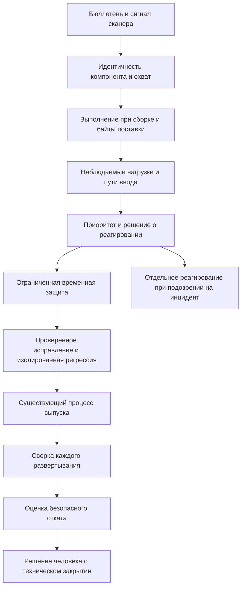

# Пример ревью: срочная уязвимость в работающем продукте

[Срочная уязвимость в работающем продукте](../../vulnerability-response/overview.ru.md) / Пример ревью.

Синтетическое ревью проекта, версия 0.1. `design-v0` и `design-v1` обозначают вымышленные варианты проекта, а не коммиты. Замечания являются учебными гипотезами; исправления предложены, но не применены; исходные и повторные проверки не выполнялись.

## Модель и предположения

Вымышленный `report-service-demo` разбирает документы партнера с помощью `parser-demo` в API и фоновом исполнителе. Запросы обслуживают два вымышленных региона. `ADVISORY-DEMO-01` является учебным идентификатором, а не реальным CVE или бюллетенем поставщика. Для примера предполагается затронутый диапазон `parser-demo` 1.x и предполагаемое исправление в 2.x. Условия версий относятся только к примеру; при реальной оценке их заменяют условиями фактического поставщика.

Сценарий начинается с сигнала сканера для образа API и записи, имитирующей бюллетень поставщика. Охват включает API, фоновые исполнители, задания повторной обработки по расписанию, оба региона и шаг сборки, запускающий парсер для преобразования тестовых данных. Имена и метки артефактов ниже являются тестовыми значениями; при оценке используйте фактические дайджесты и неизменяемые ревизии. Отчет не содержит исполняемого атакующего ввода, реального секрета или рабочей цели.

В `design-v0` манифест меняют на 2.x, но встроенная копия 1.x остается в исполнителе. Чистый отчет для API считают подтверждением исправления всего сервиса. Временное отключение функции API не влияет на обработку очереди исполнителем. Развертывание успешно в одном регионе, а в другом остается старый образ исполнителя. Стандартный вариант отката также содержит затронутый парсер. Реальное состояние для подтверждения этих гипотез не исследовалось.

## Предлагаемое реагирование в design-v1

1. Сохранить исходную редакцию бюллетеня, идентичность сканера и его базы. Подтвердить экосистему, компонент и точные условия затронутости; проследить выбранные и встроенные копии до дайджестов и платформ артефактов и фактических рабочих нагрузок. Выполнение при сборке учитывать отдельно от наличия в рабочей среде.
2. Отдельно записать доступный извне разбор и ввод партнера через очередь. Неизвестный состав или достижимость остаются неопределенными. Назначить приоритет по плейбуку управления уязвимостями; достоверные признаки компрометации запускают реагирование на инцидент с отдельным ответственным и сохранением подтверждений.
3. Временно отключить затронутую операцию разбора и на границе API, и у исполнителя по записанному решению с ограниченным сроком действия. Сохранить идентичность принятых элементов очереди и защищенные подтверждения для согласованного решения о восстановлении; не подтверждать и не отбрасывать принятую работу незаметно. Незатронутый эндпоинт состояния остается доступным. Такая защита не означает исправления парсера.
4. Предложить проверенное обновление или удаление всех затронутых копий и пути выполнения при сборке. При реализации связать исправление с фактическим коммитом и новым дайджестом артефакта. В разрешенной изолированной среде проверить исходный путь и существенные обходы на безопасных тестовых данных, а также штатный ввод партнера; записать совместимость и поведение при отказах.
5. Доставить исправление через существующий маршрут CI/CD и сверить все регионы, экземпляры, исполнители и задания по расписанию с наблюдаемыми дайджестами и конфигурацией. Подготовить откат к отдельно оцененному безопасному варианту. При регрессии и отсутствии такого варианта использовать согласованный ограниченный план сдерживания с учетом влияния на сервис; не возвращать уязвимый образ незаметно.
6. Сохранить открытыми задачи по оставшимся активам и невыполненные проверки. Человек может закрыть техническое замечание в заданном охвате только по наблюдаемым подтверждениям исправления, развертывания и регрессионной проверки. Сохранить историю применимости и решений. Расследование подозрения на компрометацию остается отдельной задачей реагирования: отсутствие событий в неполном наборе журналов не подтверждает отсутствие эксплуатации, а развертывание исправления не закрывает инцидент.

## Схема доверия

## Замечания и предлагаемые исправления

| ID | design-v0 и последствие | Предлагаемый design-v1 | Требования и тесты | Повторная проверка |
| --- | --- | --- | --- | --- |
| F-VUL-001 | Обновление только манифеста пропускает встроенную копию исполнителя и парсер сборки; затронутое выполнение остается | Проследить идентичность и копии компонента до поставки и выполнения в рабочей среде и сборке | VUL-002, VUL-003; VUL-T-03, VUL-T-04, VUL-T-05, VUL-T-06 | `not-run` |
| F-VUL-002 | Отключение только в API оставляет ввод очереди доступным исполнителю; временная защита ошибочно названа исправлением | Проверить обе границы, сохранить принятую работу и проверить незатронутое штатное поведение; сохранить план исправления и срок | VUL-005, VUL-006; VUL-T-09, VUL-T-10, VUL-T-11, VUL-T-12 | `not-run` |
| F-VUL-003 | Развертывание одного региона отмечено как полное, а откат возвращает затронутый образ | Сверить все нагрузки и проверить безопасный откат либо ограниченное сдерживание | VUL-007, VUL-008; VUL-T-13, VUL-T-14, VUL-T-15, VUL-T-16 | `not-run` |
| F-VUL-004 | Истекшее исключение и слитый PR закрывают задачу; нет подтверждений развертывания и отдельного решения об инциденте | Пересмотреть предпосылки и срок; сохранить наблюдения проверок и развертывания, оставшиеся активы и отдельную ответственность за инцидент | VUL-004, VUL-009, VUL-010; VUL-T-07, VUL-T-08, VUL-T-17, VUL-T-18, VUL-T-19, VUL-T-20 | `not-run` |

Для подтверждения в своем проекте нужны точные ревизии, артефакты, достижимость и наблюдения. ID тестов связывают ожидаемые проверки с CSV, а не обозначают выполненные прогоны. Сохраняйте исходные замечания и используйте отдельные ID повторной проверки после примененного исправления.

## Пример записи решения

| Поле | Синтетическое значение |
| --- | --- |
| Охват | `report-service-demo`, оба вымышленных региона, API, исполнители, задания по расписанию и выполнение при сборке, `design-v1` |
| Применимость | Предполагается для обучения; фактических наблюдений артефакта и рабочей среды нет |
| Исправления и временная защита | Только предложены; реального изменения и ревизии исправления нет |
| Исходные и повторные проверки | `not-run` / `not-run` |
| Развертывание и откат | Не выполнялись; наблюдаемого дайджеста и результата восстановления нет |
| Исключения | Не предоставлены |
| Техническое закрытие | Не согласовано; нужны подтверждения и решение человека |
| Состояние инцидента | Реальный инцидент не расследовался; реальное подозрение требует отдельного реагирования |

[Шаблон ревью и матрица проверок](../../vulnerability-response/overview.ru.md). Запишите исходный сигнал, идентичность затронутого и исправленного состояния, прогоны, наблюдаемое развертывание, остаточный охват и следующее действие. При применении модели замените вымышленные варианты проекта фактическими ревизиями.

Автор: Defrixx. CC BY 4.0. [Использование и лицензии](../../usage/overview.ru.md).
