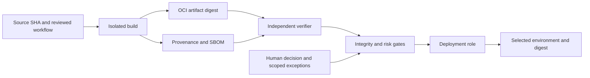

[CI/CD: requirements for a secure release](/en/hub/ci-cd-release/overview/) / Review example.

Synthetic learning review, version 0.2. `design-v0` and `design-v1` are design options, not real user commits. Repairs are proposed, checks were not executed and statuses are `not-run`.

## Model

A fictional order service builds a protected branch through GitHub Actions into an OCI image. An independent verification stage binds digest, provenance, SBOM, scan results and policy. A separate deployment role receives narrow short-lived authority for the chosen environment. A human assesses residual risk.

`orders-synthetic`, `run-demo-01` and `<digest-A>` are teaching identifiers. A real package needs exact repo/SHA, workflow revision, digest, builder/signer identity, policy/tool versions, observation times and protected evidence references. Do not replace them with plausible fabricated hashes.

## Findings and expected rechecks

| ID | design-v0 and risk | Proposed design-v1 | Checks | Status |
| --- | --- | --- | --- | --- |
| F-REL-001 | Deployment resolves `latest` after approval; the tag can change | Promote/deploy the verified digest without rebuilding; REL-004/009 | Tag change does not alter the object; new bytes rejected; normal promotion preserves digest | `not-run` |
| F-REL-002 | Any valid signature is accepted; provenance is not bound to builder/SHA | Explicit signer/builder policy and subject/source verification; REL-005/006 | Foreign identity, builder, SHA or digest rejected; selected chain accepted | `not-run` |
| F-REL-003 | Manual approval hides missing SBOM and incomplete scanning | Account for missing results, independent gates and scoped exceptions; REL-007/008/010 | Empty results never become pass; exception bound to digest/expiry; mandatory integrity checks remain required | `not-run` |

These are teaching-design hypotheses. Confirming a defect in your project needs reachability, prerequisites, impact and observations at an exact revision. Historical assessment, repair application and verification are separate states.

## Traceability and rechecks

| Finding | Requirements | CSV test IDs | Repair / recheck |
| --- | --- | --- | --- |
| F-REL-001 | REL-004, REL-009 | REL-T-05, REL-T-12, REL-T-13, REL-T-15 | Proposed / `not-run` |
| F-REL-002 | REL-005, REL-006 | REL-T-06, REL-T-07, REL-T-08, REL-T-17, REL-T-18 | Proposed / `not-run` |
| F-REL-003 | REL-007, REL-008, REL-010 | REL-T-09, REL-T-10, REL-T-11, REL-T-14, REL-T-19 | Proposed / `not-run` |

For your run fill in `finding_ids`, baseline/repair revisions, repair state and separate CSV recheck fields. Never substitute design-v1 for an actual repair revision. New requirements and tests are a test plan, not confirmed findings.

## Example decision record

| Field | Teaching value |
| --- | --- |
| Scope | `orders-synthetic` release, design option `design-v1` |
| Artifact | `<digest-A>`; no real digest was calculated |
| Integrity / provenance / signature | `not-run` / `not-run` / `not-run` |
| SBOM and vulnerability applicability | `not-run`; composition was not examined |
| Repairs | Proposed, not applied |
| Verification | `not-run` |
| Exceptions | None granted |
| Real release decision | Not taken; requires a responsible human and observed evidence |

Download the [decision template and matrix](/en/hub/ci-cd-release/overview/), retain IDs, record observations and identify unexecuted checks separately. Rollback references a verified previous artifact rather than bypassing gates.

Author: Defrixx. CC BY 4.0. [Usage and licenses](/en/hub/usage/overview/).
