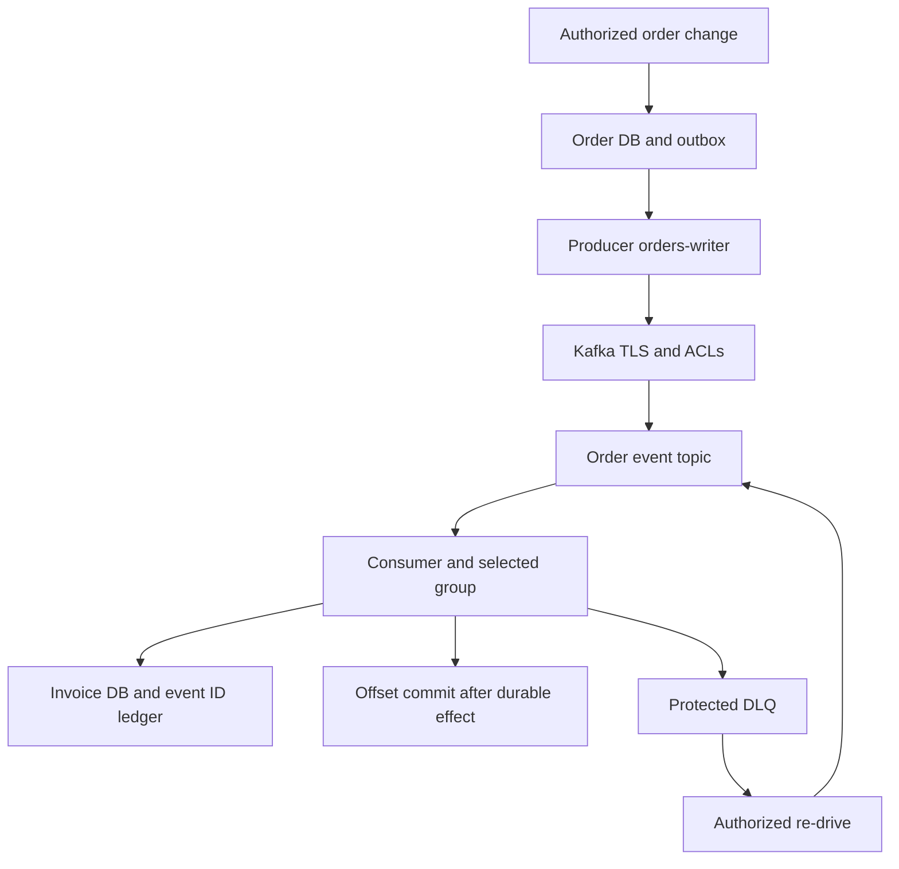

[Event integration with Kafka](/en/hub/kafka-integration/overview/) / Review example.

Synthetic design review, version 0.1. `design-v0`/`design-v1` are fictional design options, not actual commits. Findings are teaching hypotheses; repairs are proposed, not applied; baseline checks/rechecks were not executed.

## Model and assumptions

In the fictional integration, `orders-demo` sends `OrderApproved` to `billing-demo` via `prod.orders.billing.v1`. It uses ordinary consumer groups, not share groups. Selected client mutual TLS maps separate application certificates to principals; verify the mapping on the deployed platform. Test identities have no prod access. Names are fixtures, not instructions to connect to a live cluster.

`orders-writer` writes only the selected topic; `billing-reader` reads it with group `prod.billing.orders.v1` and separately writes `prod.billing.orders.dlq.v1`. Administration, topic creation and DLQ re-drive are separate roles. Check ACLs against actual APIs for the deployed version, including Describe and extra idempotent/transactional permissions when used; do not grant broad cluster rights merely to fix a client error.

Events contain `event_id`, `tenant_id`, `order_id`, `order_version`, `type`, `schema_version`, amount and currency, without shipping addresses, tokens or payment credentials. Every authorized topic reader may see this entire field set. The source checks authority to approve an order and commits an outbox event with the order change. Republishing retains event_id; payload producer_id is not proof of the author's identity.

The consumer commits `(source_contract, event_id)`, content hash and invoice mutation in one database transaction, then commits the Kafka offset. A crash after the database commit before the offset causes a safe retry. A new event_id for the same business action is additionally constrained by operation uniqueness/order version. An order-based partition key provides the required ordering domain, but the consumer still validates version/state transitions. External payment is outside this model and needs its own idempotent integration.

Invalid events never mutate invoices. After bounded retries, the protected DLQ retains the original event or an access-controlled immutable reference to its full content, together with its original ID, hash and failure reason. Minimize fields and exclude credentials in the event contract rather than truncating the replay payload. Commit source offsets after durable handoff under the selected model. When DLQ is unavailable never mask failure with acknowledgement: stop processing in a controlled manner and expose the unprocessed item. Re-drive approval binds event/destination and repeats schema, authority and duplicate checks. Retention/compaction do not imply immediate erasure across copies.

Missing matching ACLs must deny application access rather than allow everyone. Inspect effective authorizer behavior, `allow.everyone.if.no.acl.found`, `super.users` and wildcard/prefix grants. Topic/environment names alone provide no isolation. DLQ re-drive retains original contents/ID; correcting business data requires a separate authorized event linked to the original.

## Trust diagram

## Findings and proposed repairs

| ID | design-v0 / impact | Proposed design-v1 | Requirements / tests | Recheck |
| --- | --- | --- | --- | --- |
| F-KAF-001 | Consumer has Read on all groups and a shared test identity; another product manipulates the group and reads prod | Separate principals/environments and exact Topic/Group resources | KAF-003, KAF-004; KAF-T-05, KAF-T-06, KAF-T-07, KAF-T-08 | `not-run` |
| F-KAF-002 | Offsets and invoice mutations are uncoordinated and no event ledger exists; crash loses effects; retry after DB commit duplicates invoice | Source outbox, atomic ID/effect ledger and correct offset ordering | KAF-006, KAF-007; KAF-T-11, KAF-T-12, KAF-T-13, KAF-T-14 | `not-run` |
| F-KAF-003 | Shared DLQ and re-drive assigns a new event ID; operator sees excess data and repeats business effects | DLQ access/retention and authorized re-drive retaining ID/content checks | KAF-009, KAF-010; KAF-T-17, KAF-T-18, KAF-T-19, KAF-T-20 | `not-run` |

Confirmation in your project needs exact revision, reachability, prerequisites and observations. Expected results are not evidence. Preserve original findings and history through repair.

## Example decision record

| Field | Synthetic value |
| --- | --- |
| Scope | `kafka-integration-demo`, `design-v1` |
| Repairs | Proposed; no actual repair revision |
| Checks / recheck | `not-run` / `not-run` |
| Observations and evidence | Absent; no external services invoked |
| Exceptions | None granted |
| Real release decision | Not taken; a human decides using observed evidence |

[Review template and test matrix](/en/hub/kafka-integration/overview/). Fill in IDs, revisions, observations and separate rechecks. Do not substitute fictional design identifiers for SHAs.

Author: Defrixx. CC BY 4.0. [Usage and licenses](/en/hub/usage/overview/).
