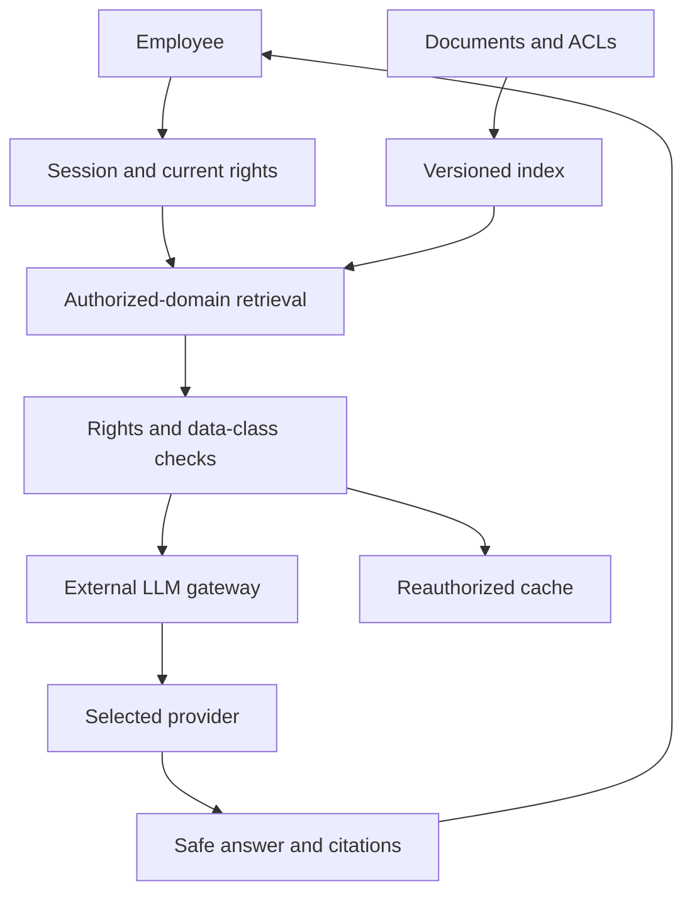

[Knowledge assistant: external LLM and RAG](/en/hub/llm-rag/overview/) / Review example.

Synthetic design review, version 0.1. `design-v0`/`design-v1` are fictional design options, not actual commits. Findings are teaching hypotheses; repairs are proposed, not applied; baseline checks/rechecks were not executed.

## Model and assumptions

The fictional `knowledge-demo` assistant answers `alpha-reader` using `OPS-17`. `SEC-42` is restricted to the security group; `beta-policy` belongs to another tenant. Tests use synthetic markers, not real restricted content. Generation is external, while the index and authorization are local; embeddings are local in this selected model. Moving embeddings outside requires a fresh disclosure assessment.

Each chunk binds `(tenant_id, document_id, document_version, acl_version)`. Search is restricted to the allowed domain, then current source rights/version are checked before constructing external context. Unknown ACLs or revocation that cannot yet be reliably enforced block the chunk. Checking after external reranking would be too late.

Cache keys include user authorization scope and policy/source revisions; a hit never bypasses reauthorization. Reused conversation history must remove or reauthorize embedded excerpts before retransmission. Citations open an authenticated document viewer that checks access again; foreign document identifiers/titles are also protected.

Each request rebuilds authorized context without provider-managed conversation history. This does not promise zero retention: service logs and application state are assessed separately. Revocation after dispatch cannot recall bytes; block new disclosure/stale answer delivery and account for the exposure window and follow-up. Source deletion does not establish erasure of indexes, backups or provider copies.

## Trust diagram

## Findings and proposed repairs

| ID | design-v0 / impact | Proposed design-v1 | Requirements / tests | Recheck |
| --- | --- | --- | --- | --- |
| F-RAG-001 | ACL filtering occurs after external reranking; SEC-42 reaches the provider before answer filtering | Enforce current ACL before every external stage | RAG-002, RAG-003; RAG-T-03, RAG-T-04, RAG-T-05, RAG-T-06 | `not-run` |
| F-RAG-002 | Answer cache is shared and ignores group revocation; another user or revoked group receives stale text | Scope cache and reauthorize history/source | RAG-007, RAG-008; RAG-T-13, RAG-T-14, RAG-T-15, RAG-T-16 | `not-run` |
| F-RAG-003 | Retrieved document controls outgoing answer links; external resource receives data or browser executes markup | Treat context as data; safe rendering and no automatic fetch | RAG-005, RAG-006; RAG-T-09, RAG-T-10, RAG-T-11, RAG-T-12 | `not-run` |

Confirmation in your project needs exact revision, reachability, prerequisites and observations. Expected results are not evidence. Preserve original findings and history through repair.

## Example decision record

| Field | Synthetic value |
| --- | --- |
| Scope | `llm-rag-demo`, `design-v1` |
| Repairs | Proposed; no actual repair revision |
| Checks / recheck | `not-run` / `not-run` |
| Observations and evidence | Absent; no external services invoked |
| Exceptions | None granted |
| Real release decision | Not taken; a human decides using observed evidence |

[Review template and test matrix](/en/hub/llm-rag/overview/). Fill in IDs, revisions, observations and separate rechecks. Do not substitute fictional design identifiers for SHAs.

Author: Defrixx. CC BY 4.0. [Usage and licenses](/en/hub/usage/overview/).
