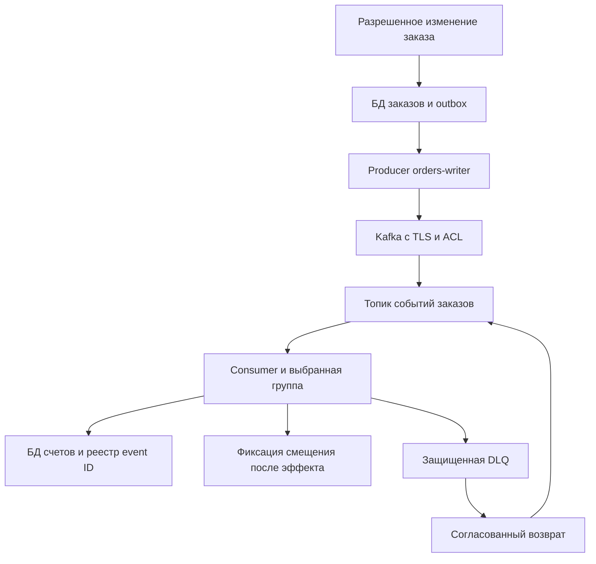

[Событийная интеграция через Kafka](/ru/hub/kafka-integration/overview/) / Пример ревью.

Синтетический проектный разбор, версия 0.1. `design-v0`/`design-v1` - варианты вымышленной архитектуры, не реальные коммиты. Замечания - учебные гипотезы; исправления предложены, не применены; исходные и повторные проверки не выполнялись.

## Модель и допущения

В вымышленной интеграции `orders-demo` передает `OrderApproved` продукту `billing-demo` через `prod.orders.billing.v1`. Используются обычные группы потребителей, а не share groups. В выбранной модели клиентский TLS с взаимной аутентификацией связывает отдельные сертификаты приложений с principal; конкретное сопоставление проверяется в используемой платформе. Отдельные тестовые идентичности не получают доступа к prod. Имена в примере - фикстуры, а не инструкция подключаться к реальному кластеру.

Производитель `orders-writer` может писать только выбранный топик; `billing-reader` читает его с группой `prod.billing.orders.v1` и отдельно может писать в `prod.billing.orders.dlq.v1`. Администрирование, создание топиков и возврат из DLQ вынесены из этих ролей. Таблица ACL проверяется на фактических API используемой версии, включая Describe и дополнительные разрешения идемпотентного/транзакционного режима, если он выбран; широкие права на кластер не выдаются ради устранения ошибки клиента.

Событие содержит `event_id`, `tenant_id`, `order_id`, `order_version`, `type`, `schema_version`, сумму и валюту, без адреса доставки, токенов и платежных реквизитов. Все разрешенные читатели топика имеют право на весь этот состав. Источник проверяет право одобрить заказ и сохраняет событие в outbox с изменением заказа. Повтор отправки сохраняет event_id; поле producer_id в теле не считается доказательством личности автора.

Получатель одной транзакцией БД учитывает `(source_contract, event_id)`, хеш содержимого и изменение счета; затем фиксирует смещение Kafka. Сбой после БД до смещения приводит к безопасному повтору. Новый event_id той же бизнес-операции дополнительно ограничен уникальным ключом операции/версией заказа. Разделение по ключу заказа сохраняет нужную область порядка, но потребитель все равно проверяет версию и допустимый переход. Внешний платеж в эту модель не входит: для него нужна отдельная идемпотентная интеграция.

Некорректное событие не меняет счет. После ограниченных повторов защищенная DLQ получает исходный ID, минимальные поля, хеш и причину без учетных данных. Смещение исходного потока фиксируют после надежной передачи согласно выбранной модели. Если DLQ недоступна, ошибку не маскируют подтверждением: обработка останавливается управляемо, оператор видит необработанный элемент. Возврат согласовывается для конкретного события/назначения и проходит те же проверки схемы, полномочий и дублей. Retention и compaction не означают мгновенное удаление всех копий.

Отсутствие подходящей ACL должно закрывать доступ приложения, а не открывать его всем. Проверяйте фактический режим авторизатора, `allow.everyone.if.no.acl.found`, `super.users` и охват wildcard/prefix-прав. Имена топика/окружения сами по себе изоляции не дают. При возврате из DLQ исходное содержимое и ID не меняются; исправление бизнес-данных оформляют отдельным разрешенным событием со связью с исходным.

## Схема доверия

## Замечания и предложенные исправления

| ID | design-v0 / последствие | Предложение design-v1 | Требования / тесты | Повторная проверка |
| --- | --- | --- | --- | --- |
| F-KAF-001 | Consumer имеет Read на все группы и общую тестовую идентичность; Другой продукт управляет группой и читает prod | Раздельные principal/среды и точные ресурсы Topic/Group | KAF-003, KAF-004; KAF-T-05, KAF-T-06, KAF-T-07, KAF-T-08 | `not-run` |
| F-KAF-002 | Смещение и изменение счета не согласованы, реестра event ID нет; Сбой теряет эффект; повтор после БД создает второй счет | Outbox источника, атомарный реестр ID/эффекта и правильный порядок смещения | KAF-006, KAF-007; KAF-T-11, KAF-T-12, KAF-T-13, KAF-T-14 | `not-run` |
| F-KAF-003 | DLQ общая и возврат создает новый event ID; Оператор видит лишние данные и повторяет бизнес-действие | Права/срок DLQ, согласованный возврат с исходным ID и проверкой содержимого | KAF-009, KAF-010; KAF-T-17, KAF-T-18, KAF-T-19, KAF-T-20 | `not-run` |

Для подтверждения в своем проекте нужны точная ревизия, достижимость, предпосылки и наблюдения. Ожидаемый результат не является доказательством. Сохраняйте первоначальное замечание и историю при исправлении.

## Пример записи решения

| Поле | Синтетическое значение |
| --- | --- |
| Область | `kafka-integration-demo`, `design-v1` |
| Исправления | Предложены; фактической ревизии исправления нет |
| Проверки / повторная проверка | `not-run` / `not-run` |
| Наблюдения и доказательства | Отсутствуют; внешние сервисы не вызывались |
| Исключения | Не выданы |
| Решение о реальном выпуске | Не принято; принимает человек по фактическим данным |

[Шаблон отчета и матрица проверок](/ru/hub/kafka-integration/overview/). Заполните ID, ревизии, наблюдения и отдельные результаты повторной проверки. Синтетические обозначения не подставляйте вместо SHA.

Автор: Defrixx. CC BY 4.0. [Использование и лицензии](/ru/hub/usage/overview/).
