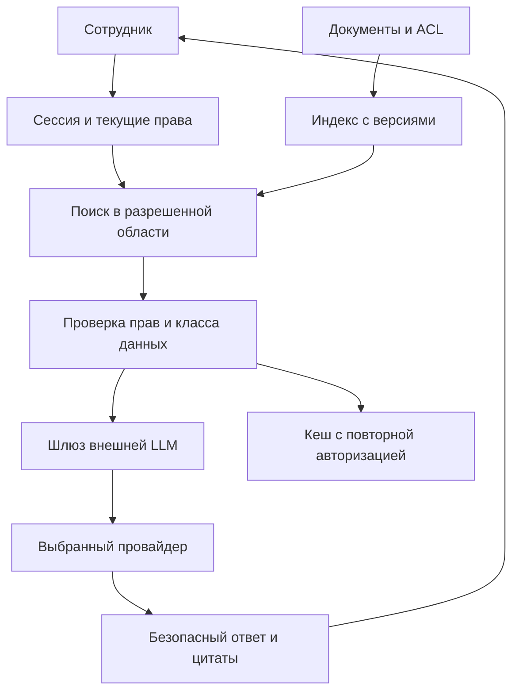

[ИИ-помощник: внешняя LLM и внутренние знания](/ru/hub/llm-rag/overview/) / Пример ревью.

Синтетический проектный разбор, версия 0.1. `design-v0`/`design-v1` - варианты вымышленной архитектуры, не реальные коммиты. Замечания - учебные гипотезы; исправления предложены, не применены; исходные и повторные проверки не выполнялись.

## Модель и допущения

Вымышленный помощник `knowledge-demo` отвечает сотруднику `alpha-reader` по инструкции `OPS-17`. Документ `SEC-42` доступен только группе безопасности; `beta-policy` принадлежит другому tenant. Для тестов используются синтетические маркеры, а не реальные закрытые сведения. Генерация внешняя, индекс и проверка прав локальные; эмбеддинги в выбранной модели локальные. Переход на внешние эмбеддинги требует новой оценки передачи данных.

Сервер связывает каждый фрагмент с `(tenant_id, document_id, document_version, acl_version)`. Поиск ограничен разрешенной областью, затем актуальные права/версия сверяются с источником до формирования внешнего контекста. Если ACL неизвестна или отзыв еще нельзя надежно учесть, фрагмент не отправляют. Проверка после внешнего ранжирования была бы слишком поздней.

Ключ кеша включает область пользователя и ревизию политики/источников; попадание в кеш не отменяет повторную авторизацию. Перед повторной отправкой истории удаляют или заново разрешают содержащиеся в ней фрагменты. Цитата ведет в защищенный просмотр документа, где доступ проверяется снова; идентификаторы и заголовки чужих документов также не раскрываются.

Каждый запрос заново собирает разрешенный контекст без серверной истории диалога провайдера. Это не обещание нулевого хранения: служебные журналы и данные приложения учитывают отдельно. Отзыв после отправки не возвращает переданные байты; блокируют новые передачи и выдачу устаревшего ответа, фиксируют окно и дальнейшие действия. Удаление источника не подтверждает удаление индекса, резервных копий или копии провайдера.

## Схема доверия

## Замечания и предложенные исправления

| ID | design-v0 / последствие | Предложение design-v1 | Требования / тесты | Повторная проверка |
| --- | --- | --- | --- | --- |
| F-RAG-001 | Фильтр ACL стоит после внешнего ранжирования; SEC-42 уже раскрыт провайдеру до фильтрации ответа | Проверка текущей ACL до любого внешнего этапа | RAG-002, RAG-003; RAG-T-03, RAG-T-04, RAG-T-05, RAG-T-06 | `not-run` |
| F-RAG-002 | Кеш ответа общий, отзыв группы его не очищает; Второй пользователь или отозванная группа получает прежний текст | Область кеша и повторная авторизация истории/источника | RAG-007, RAG-008; RAG-T-13, RAG-T-14, RAG-T-15, RAG-T-16 | `not-run` |
| F-RAG-003 | Цитируемый документ управляет внешними ссылками ответа; Внешний ресурс получает данные либо браузер исполняет разметку | Контекст как данные, безопасный рендеринг и запрет автоматической загрузки | RAG-005, RAG-006; RAG-T-09, RAG-T-10, RAG-T-11, RAG-T-12 | `not-run` |

Для подтверждения в своем проекте нужны точная ревизия, достижимость, предпосылки и наблюдения. Ожидаемый результат не является доказательством. Сохраняйте первоначальное замечание и историю при исправлении.

## Пример записи решения

| Поле | Синтетическое значение |
| --- | --- |
| Область | `llm-rag-demo`, `design-v1` |
| Исправления | Предложены; фактической ревизии исправления нет |
| Проверки / повторная проверка | `not-run` / `not-run` |
| Наблюдения и доказательства | Отсутствуют; внешние сервисы не вызывались |
| Исключения | Не выданы |
| Решение о реальном выпуске | Не принято; принимает человек по фактическим данным |

[Шаблон отчета и матрица проверок](/ru/hub/llm-rag/overview/). Заполните ID, ревизии, наблюдения и отдельные результаты повторной проверки. Синтетические обозначения не подставляйте вместо SHA.

Автор: Defrixx. CC BY 4.0. [Использование и лицензии](/ru/hub/usage/overview/).
