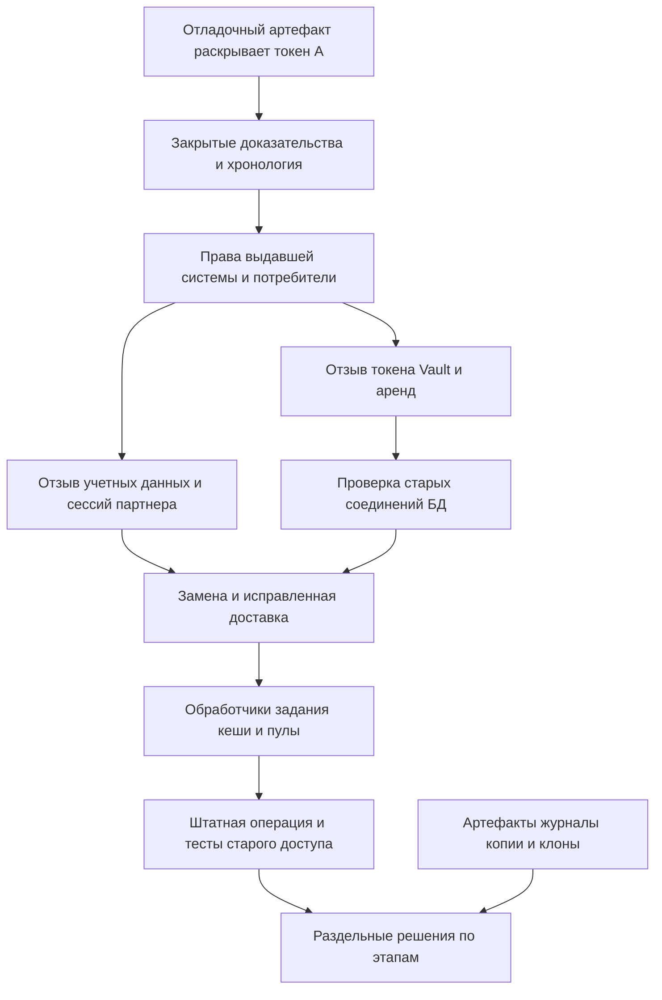

[Утечка секрета работающего сервиса](/ru/hub/secret-exposure-response/overview/) / Пример ревью.

Синтетическое ревью проекта, версия 0.1. `design-v0` и `design-v1` обозначают вымышленные варианты проекта, а не коммиты. Замечания служат учебными гипотезами; исправления предложены, но не применены. Все исходные и повторные проверки имеют статус `not-run`. Обращений к выдавшей системе, БД или сервису нет.

## Модель и предположения

Вымышленный `report-worker-demo` использует сервисный токен Vault, представленный только условным именем `worker-vault-A`. Отладочная выгрузка помещает его значение в артефакт сборки. Условные имена не являются действующими учетными данными. Самое раннее возможное раскрытие начинается с первой публикации артефакта; пробелы аудита до обнаружения остаются неизвестными, а не доказательством отсутствия злоупотребления.

Токен позволяет читать статические учетные данные партнера и запрашивать динамические учетные данные БД для роли обработчика. Поэтому реестр включает токен Vault, все доступные статические учетные данные, выданные аренды БД, производные сессии партнера и существующие соединения с БД. Оцените фактические права и историю выдачи и доступа; имя политики само по себе не определяет реальный охват. Механизм сессий партнера является вымышленным контрактом этого примера, а не поведением Vault или БД.

Локализация по согласованной процедуре включает отзыв раскрытого токена Vault и проверку результата отзыва связанных аренд. Статические учетные данные отдельно отзываются у партнера, а сессии партнера отключаются по его контракту. Удаление записи KV не выполняет этот внешний отзыв. Неудачный отзыв аренды или ошибка системы БД остается открытой работой, для которой нужны действующее ограничение у ресурса и ответственный.

Изменение пароля БД и запрет новой аутентификации не подтверждают завершение уже аутентифицированного соединения. Процедура выбранной БД и подключенного механизма выдачи должна проверять существующие сессии и при необходимости завершать их или запрещать защищенные операции другим способом. Временные облачные учетные данные, если они обнаружены в охвате, проверяются по Cloud IAM: удаление доверия к федерации останавливает только новую выдачу; для уже выданных учетных данных нужна отдельная проверка действующего запрета. Диагностический запрос идентичности, например AWS `GetCallerIdentity`, не подтверждает запрет доступа к защищенному ресурсу.

Замена идентичности Vault и учетных данных партнера получает проверенные минимальные права. Отладочный путь утечки исправляется до доставки замены. Каждый активный обработчик и задание по расписанию подтверждает новое условное имя и версию; для кешированных сессий и пулов БД явно задано перечитывание или переподключение. Разрешенные проверки используют изолированные тестовые данные: штатное формирование отчета и попытки со старыми учетными данными, старыми сессиями и устаревшим обработчиком.

Очистка репозитория, артефактов и журналов идет после локализации с сохранением закрытых доказательств. Неизвестные внешние клоны и сохраняемые резервные копии учитываются с ответственными, ограничениями доступа и следующими действиями. Восстановление копии или откат обработчика сохраняет актуальные ссылки на учетные данные и исправленное журналирование. Повторное шифрование копии KV не устраняет уже произошедшее раскрытие открытого текста.

## Схема доверия

## Замечания и предложенные исправления

| ID | design-v0 / последствия | Предложенный design-v1 | Требования / тесты | Повторная проверка |
| --- | --- | --- | --- | --- |
| F-SEC-001 | Проверен только последний исходный файл и удален артефакт; токен Vault и доступ к партнеру остаются действующими | Закрытая хронология, реестр выдавших систем, прав и потребителей, немедленная локализация компрометации | SEC-001, SEC-002, SEC-003; SEC-T-01, SEC-T-02, SEC-T-03, SEC-T-04, SEC-T-05, SEC-T-06 | `not-run` |
| F-SEC-002 | KV обновлен и новый вход отклонен; старые статические учетные данные партнера, производная сессия или активное соединение БД пропущены | Результаты отзыва у выдавших систем и отдельные тесты производного доступа, сессий и соединений; при необходимости действующий запрет у ресурса | SEC-004, SEC-007; SEC-T-07, SEC-T-08, SEC-T-13, SEC-T-14 | `not-run` |
| F-SEC-003 | Замена идет тем же отладочным путем утечки; устаревшее задание и откат продолжают выбирать старую версию | Исправить доставку, ограничить права замены, проверить каждого потребителя и сохранить безопасные учетные данные при откате | SEC-005, SEC-006, SEC-009; SEC-T-09, SEC-T-10, SEC-T-11, SEC-T-12, SEC-T-17, SEC-T-18 | `not-run` |
| F-SEC-004 | Чистое сканирование закрывает инцидент, хотя старый артефакт и хранение защищенных доказательств не учтены | Учесть копии и закрывать локализацию, восстановление и очистку отдельно по фактическим доказательствам | SEC-008, SEC-010; SEC-T-15, SEC-T-16, SEC-T-19, SEC-T-20 | `not-run` |

Подтвердите каждую гипотезу в своем проекте по точной ревизии, области и наблюдениям. Сохраните исходное замечание и отдельную повторную проверку; ожидаемые результаты не являются доказательствами.

## Пример записи решения

| Поле | Синтетическое значение |
| --- | --- |
| Область | `report-worker-demo`, `design-v1` |
| Исправления | Предложены; фактической ревизии исправления нет |
| Локализация / восстановление / очистка | Не выполнялись / не выполнялись / не выполнялись |
| Проверки / повторные проверки | `not-run` / `not-run` |
| Наблюдения и доказательства | Отсутствуют; действий с учетными данными и инфраструктурой не было |
| Исключения | Не предоставлены |
| Закрытие реального инцидента | Не выполнялось; ответственный человек оценивает фактические доказательства и оставшиеся работы |

[Шаблон ревью и матрица проверок](/ru/hub/secret-exposure-response/overview/). Укажите реальные ревизии, разрешенные наблюдения и ссылки на закрытые доказательства; вымышленные ID проекта не заменяют SHA.

Автор: Defrixx. CC BY 4.0. [Использование и лицензии](/ru/hub/usage/overview/).
